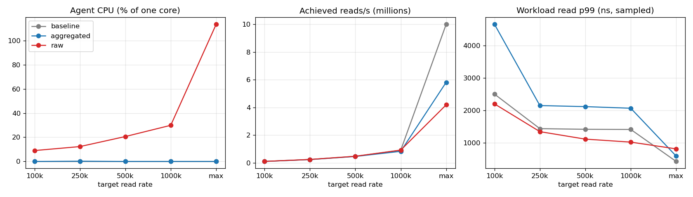
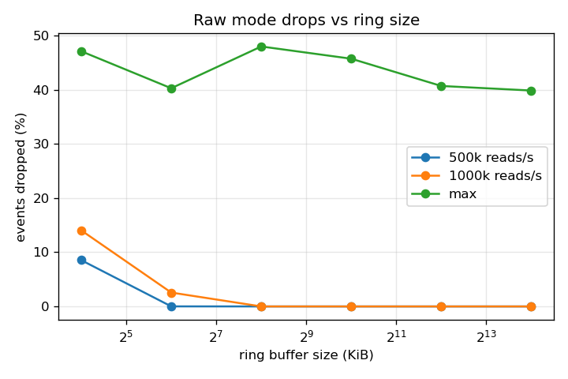

# Benchmarks

How much does observing a process cost, and does doing the aggregation in the kernel actually make it cheaper than shipping every event to userspace?

Three configurations run the same workload:

| mode | what runs |
| --- | --- |
| baseline | no agent |
| aggregated | `tracelens agent`: counters and histograms in per-CPU BPF maps, read once a second |
| raw | `tracelens agent -export-all`: every finished call goes through the ring buffer; the kernel skips aggregation and Go does the same aggregation per event |

The workload is `bin/loadgen`: two OS threads issuing 1-byte `read` calls on `/dev/zero`, either paced to a target total rate or unthrottled. A `/dev/zero` read takes about 200 ns, so probe overhead is a large share of each call. That's deliberate: it's close to the worst case for per-syscall tracing, not a typical application.

## Environment

All numbers come from one machine, and none of them should be compared with numbers from anywhere else. Full metadata is in [`benchmarks/results/env.txt`](../benchmarks/results/env.txt).

- Lima 2.2.1 VM (Apple Virtualization.framework), 4 vCPUs, 4 GiB, Ubuntu 24.04.5, kernel 6.8.0-142-generic, arm64
- Host: M4 MacBook Air, macOS 26.0; power source and other host load not recorded
- No CPU pinning, no isolation, no frequency control: the VM can't do any of those

Reproduce with:

```
make build
scripts/linux.sh benchmarks/overhead.sh   > benchmarks/results/overhead.csv
scripts/linux.sh benchmarks/ringsweep.sh  > benchmarks/results/ringsweep.csv
scripts/linux.sh env RATE=0 benchmarks/probe_cost.sh > benchmarks/results/probe_cost_max.csv
python3 benchmarks/plot.py benchmarks/results
```

## Overhead by rate

Medians of three 5-second runs per cell ([`overhead.csv`](../benchmarks/results/overhead.csv)). Agent CPU is user + system time of the agent process from `/proc/<pid>/stat`, as a percentage of one core. It doesn't include time spent in BPF programs, which is charged to the thread making the syscall.

| target reads/s | mode | achieved reads/s | agent CPU | events dropped |
| --- | --- | --- | --- | --- |
| 100k | baseline | 94k | | |
| | aggregated | 93k | 0.0% | |
| | raw | 96k | 9.0% | 0 |
| 500k | baseline | 461k | | |
| | aggregated | 453k | 0.0% | |
| | raw | 468k | 20.6% | 0 |
| 1M | baseline | 904k | | |
| | aggregated | 825k | 0.0% | |
| | raw | 913k | 29.9% | 0 |
| unthrottled | baseline | 10.0M | | |
| | aggregated | 5.81M | 0.0% | |
| | raw | 4.18M | 113.5% | 8.7M per run |



What this shows:

- **Aggregated mode costs the agent essentially nothing.** Reading the stats map once a second is a few hundred map entries no matter how many syscalls happened.
- **Raw mode's agent CPU grows with the event rate**: about 9% of a core at 100k events/s and 30% at 1M, and at the unthrottled rate the single consumer goroutine saturates and the kernel drops 40-48% of events.
- **Unthrottled, both modes slow the workload a lot**: baseline does 10.0M reads/s, aggregated 5.81M, raw 4.18M. Since every call pays for the BPF programs on its own thread, this is the clearest view of per-call cost.
- **At 1M reads/s, aggregated mode missed the target** (825k vs 904k baseline) while raw kept up. The paced loop issues a 1 ms slot's worth of calls back to back, and in aggregated mode those calls are slower. Why they're slower at paced rates is the next section.

The workload latency columns in the CSV and the right-hand plot need a caveat, below.

## Time inside the BPF programs

`probe_cost.sh` turns on `kernel.bpf_stats_enabled`, which makes the kernel record run time per program, and divides by loadgen's read count. That includes the scheduler hooks and other processes' syscalls, so it's an upper bound per read. Stats collection adds its own clock reads, so these runs are separate from the ones above.

| load | mode | ns per program run | BPF ns per read |
| --- | --- | --- | --- |
| unthrottled | aggregated | 60 | 120 |
| unthrottled | raw | 117 | 234 |
| 500k reads/s | aggregated | 248 | 501 |
| 500k reads/s | raw | 123 | 257 |

These are single runs, and the 500k rows turned out not to be reproducible.

### Repeated runs

Later, while checking the cost of read-wait tracking, each configuration was run in the same Lima VM three times unthrottled and three to six times at 500k reads/s, with and without that change ([`probe_cost_repeat.csv`](../benchmarks/results/probe_cost_repeat.csv)). Ranges of ns per program run:

| load | mode | without read wait | with read wait |
| --- | --- | --- | --- |
| unthrottled | aggregated | 72–85 | 67–75 |
| unthrottled | raw | 148–215 | 154–171 |
| 500k reads/s | aggregated | 79–169 | 85–174 |
| 500k reads/s | raw | 217–239 | 210–341 |

Read-wait tracking adds a hash lookup to every `read` exit, and for this workload (blocking reads, no EAGAIN, no `close` in the loop) that doesn't show up above the run-to-run spread. The insert on EAGAIN and the delete on `close` weren't exercised, so EAGAIN-heavy or close-heavy workloads aren't covered by these numbers.

At 500k reads/s the aggregated path varies by 2x between identical runs, and in every repeated run it was cheaper than the raw path. The single run in the first table (248 ns aggregated, 123 ns raw) isn't representative. An earlier version of this page explained it with cold caches; with these runs there's nothing left to explain. The paced numbers in this VM are too noisy to say more than "aggregation is cheaper per run".

Raw mode costs more per run than it did in the first table (about 150–170 ns versus 117 ns unthrottled). Those runs used the old decoder, which left 40–48% of reservations failing, and a failed `bpf_ringbuf_reserve` returns before writing anything. That might account for the difference, but it hasn't been isolated.

## The latency numbers are confounded

At paced rates, raw mode shows a lower workload p99 than baseline (1.0 µs vs 1.4 µs at 1M reads/s). That can't mean tracing made reads faster. A separate check: baseline at 500k reads/s, with and without an unrelated `while :; do :; done` loop on another vCPU, three runs each:

| | p50 | p99 |
| --- | --- | --- |
| baseline | 292-299 ns | 1375-1417 ns |
| baseline + busy loop | 209-250 ns | 584-603 ns |

A busy vCPU elsewhere in the VM cuts the workload's p99 by more than half. Raw mode's consumer is exactly such a busy thread. So at paced rates, latency differences between modes mostly reflect how idle the VM is, not tracing cost, and the throughput and BPF-time numbers above are the ones to trust. Fixing this properly needs CPU isolation and a pinned frequency, which this setup can't do.

## Ring buffer size

Raw mode at fixed rates with ring sizes from 16 KiB to 16 MiB ([`ringsweep.csv`](../benchmarks/results/ringsweep.csv)). One 5-second run per cell. An event is 56 bytes plus an 8-byte header.

| ring | 500k/s | 1M/s | unthrottled (~4.1M/s) |
| --- | --- | --- | --- |
| 16 KiB | 8.54% | 14.04% | 47.10% |
| 64 KiB | 0.01% | 2.56% | 40.27% |
| 256 KiB | 0 | 0 | 47.98% |
| 1 MiB | 0 | 0 | 45.72% |
| 4 MiB | 0 | 0 | 40.69% |
| 16 MiB | 0 | 0 | 39.85% |



Up to 1M events/s, 256 KiB (the default) is enough. Unthrottled, the consumer delivers about 2.2M events/s and no ring size helps: a bigger buffer absorbs a burst, but under sustained overload it only delays when drops start. The variation between 40% and 48% is run-to-run noise in a single run per cell.

### After fixing the consumer

The runs above used `binary.Read` to decode each event. Go microbenchmarks on the M4 host put that at 220 ns and two allocations per event, against 6 ns for the mutex-guarded totals update, so decoding was about half of the ~450 ns per event the consumer could spend at 2.2M events/s. Reading the fields by offset brought decode to 7.5 ns with no allocations.

Rerunning the sweep at the default 256 KiB ring, three 5-second runs each ([`ringsweep_fast_decode.csv`](../benchmarks/results/ringsweep_fast_decode.csv)):

| target | delivered per run | dropped |
| --- | --- | --- |
| 1M/s | 4.45M-4.49M | 0 |
| unthrottled | 18.7M-19.2M (about 3.8M/s) | 5.25-6.26% |

So the consumer ceiling went from about 2.2M to about 3.8M events/s. The overhead table and plot above still come from the old decoder; raw mode's agent CPU there is higher than it would be now, and hasn't been remeasured.
