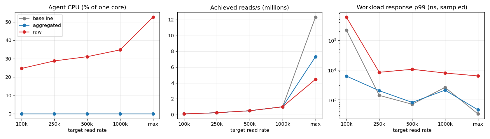
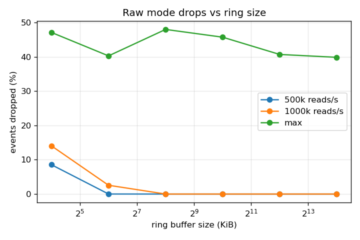

# Benchmarks

How much does observing a process cost, and does doing the aggregation in the kernel actually make it cheaper than shipping every event to userspace?

Three configurations run the same workload:

| mode | what runs |
| --- | --- |
| baseline | no agent |
| aggregated | `tracelens agent`: counters and histograms in per-CPU BPF maps, read once a second |
| raw | `tracelens agent -export-all`: every finished call goes through the ring buffer; the kernel skips aggregation and Go does the same aggregation per event |

The workload is `bin/loadgen`: two OS threads issuing 1-byte `read` calls on `/dev/zero`, either paced to a target total rate or unthrottled. A `/dev/zero` read takes about 160 ns, so probe overhead is a large share of each call. That's deliberate: it's close to the worst case for per-syscall tracing, not a typical application.

## Environment

All numbers come from one machine, and none of them should be compared with numbers from anywhere else.

- Lima 2.2.1 VM (Apple Virtualization.framework), 4 vCPUs, 4 GiB, Ubuntu 24.04.5, kernel 6.8.0-142-generic, arm64
- Host: M4 MacBook Air, macOS 26.0
- No CPU pinning, no isolation, no frequency control: the VM can't do any of those

The conditions for the main results are in [`env_quiet.txt`](../benchmarks/results/env_quiet.txt): the host's load average stayed between 2.5 and 3.4, on battery.

Reproduce with:

```
make build
scripts/linux.sh benchmarks/overhead.sh  > benchmarks/results/overhead_quiet.csv
scripts/linux.sh env RATE=0 benchmarks/probe_cost.sh
scripts/linux.sh benchmarks/probe_cost.sh
benchmarks/ab.sh <older-ref>             > benchmarks/results/ab.csv
scripts/linux.sh benchmarks/ringsweep.sh > benchmarks/results/ringsweep.csv
python3 benchmarks/plot.py benchmarks/results
```

`probe_cost.sh` prints one run, so the committed `probe_cost_quiet.csv` is five unthrottled runs and three at 500k with a `load` column added. `probe_cost_hooks_ab_quiet.csv` came from the same loop that `ab.sh` now wraps, with longer build names.

## Results

`loadgen` follows a fixed schedule: call n is due at start + n/rate, delayed calls run back to back, and each sampled call records service time (call start to return) and response time (due time to return). It spins between calls rather than sleeping, because a sleep's wakeup delay would count as response time. Unthrottled, there's no schedule, so the two are the same.

Medians of three 5-second runs, with every hook loaded ([`overhead_quiet.csv`](../benchmarks/results/overhead_quiet.csv)). Every paced run got within 0.3% of its target. Agent CPU is user + system time of the agent process, as a percentage of one core. It doesn't include time in BPF programs, which is charged to the thread making the syscall.

| target reads/s | mode | service p99 (µs) | response p99 (µs) | response p99, each run (µs) | agent CPU |
| --- | --- | --- | --- | --- | --- |
| 100k | baseline | 0.42 | 219 | 3.7, 219, 455 | |
| | aggregated | 0.58 | 6.3 | 0.9, 6.3, 18432 | 0.0% |
| | raw | 10.6 | 601 | 13, 601, 2230 | 24.7% |
| 250k | baseline | 0.38 | 1.4 | 1.1, 1.4, 4.5 | |
| | aggregated | 0.50 | 2.0 | 1.3, 2.0, 2.1 | 0.0% |
| | raw | 7.8 | 8.4 | 8.0, 8.4, 11 | 28.8% |
| 500k | baseline | 0.38 | 0.71 | 0.47, 0.71, 1.4 | |
| | aggregated | 0.50 | 0.82 | 0.54, 0.82, 2.4 | 0.0% |
| | raw | 7.6 | 11 | 8.0, 11, 12 | 31.1% |
| 1M | baseline | 0.38 | 2.6 | 1.1, 2.6, 3.1 | |
| | aggregated | 0.50 | 2.1 | 0.9, 2.1, 3.5 | 0.0% |
| | raw | 7.5 | 7.9 | 7.9, 7.9, 8.3 | 34.8% |

Unthrottled:

| mode | reads/s, each run | service p99 (µs) | agent CPU | events dropped per run |
| --- | --- | --- | --- | --- |
| baseline | 11.39M, 12.32M, 12.39M | 0.33 | | |
| aggregated | 7.31M, 7.32M, 7.33M | 0.46 | 0.0% | 0 |
| raw | 4.46M, 4.46M, 4.48M | 6.3 | 52.6% | 776,552 (about 3.5% of reads) |

At 1M reads/s, raw mode dropped 0, 0 and 1,939 events.

Time inside the BPF programs, from `kernel.bpf_stats_enabled` divided by loadgen's read count ([`probe_cost_quiet.csv`](../benchmarks/results/probe_cost_quiet.csv)). That includes the scheduler hooks and other processes' syscalls, so it's an upper bound per read. Stats collection adds its own clock reads and slows the workload, so these runs are separate from the ones above.

| load | mode | BPF ns per read | program runs per read |
| --- | --- | --- | --- |
| unthrottled, five runs | aggregated | 105–108 | 2.00 |
| unthrottled, five runs | raw | 275–281 | 2.05 |
| 500k reads/s, three runs | aggregated | 110–112 | 2.00 |
| 500k reads/s, three runs | raw | 1019–1062 | 2.38 |



What this shows:

- **BPF time explains most of the throughput loss.** At the median, each of the two threads spends about 162 ns per read at baseline, 273 ns aggregated and 448 ns raw. That adds 111 and 286 ns, against 105 and 278 ns measured inside the programs. The match is rough: baseline varied by about 9% between runs, the BPF numbers come from separate runs with stats on, and tracepoint dispatch outside the programs should cost something too.
- **Aggregated mode costs the agent essentially nothing.** Reading the stats map once a second is a few hundred map entries however many syscalls happened.
- **Raw mode's BPF cost per read is nearly four times higher at 500k than unthrottled.** There are only 2.38 program runs per read, so the cost isn't a program firing on every event. Waking the consumer on some submits is one candidate, which would also fit its agent CPU staying near 25% at 100k reads/s. Neither has been tested.
- **Aggregation's cost doesn't change when paced**, at least with this spinning workload. An earlier run with a sleeping `loadgen` measured it four times slower, and repeats on a busy host didn't reproduce that. The sleeping condition hasn't been rerun on a quiet host.
- **At 250k and above, raw mode's median response p99 is 8–11 µs against 0.7–2.6 µs for the other two.** Baseline and aggregated can't be separated from three runs.
- **The 100k row can't be used to compare modes.** Two baseline runs, one aggregated run and two raw runs hit stalls of up to 18 ms. 100k is also always the first rate in `overhead.sh`, and the worst values are in its first two repetitions, so this may be warm-up and not the rate.

### Cost of the newer hooks

A build from before response, off-CPU and retransmit tracking was alternated with the current one five times ([`probe_cost_hooks_ab_quiet.csv`](../benchmarks/results/probe_cost_hooks_ab_quiet.csv)). Aggregated took 53 ns per program run in all five older runs and 53–55 ns in the newer ones. Raw took 135–138 ns and 135–137 ns. That covers `read` only: the workload doesn't exercise the `write`, TCP or sleep paths.

## Host load changes everything

Earlier benchmarks are kept as CSVs but no longer described here, since they aren't comparable. They used an older decoder, `loadgen` or build, and most didn't record host load. [`overhead_openloop.csv`](../benchmarks/results/overhead_openloop.csv) is the useful comparison: same code as the results above, apart from a `loadgen` fix to the unthrottled loop, with the host's load average around 28.

| | load average about 28 | load average about 3 |
| --- | --- | --- |
| baseline, unthrottled | 8.03M reads/s | 12.3M reads/s |
| aggregated, unthrottled | 4.54M reads/s | 7.32M reads/s |
| baseline response p99 at 1M reads/s | 4.0 ms | 2.6 µs |
| aggregated BPF time per program run | 85–146 ns | 53–55 ns |

Those are two sittings, not a controlled experiment, so host load is the likely cause and not a proven one. Stalls also still happen on the quiet host, as the 100k row shows. Service p99 at 1M only went from 0.7 to 0.38 µs between the two, which is the case for measuring response time: service time barely saw the stalls.

[`probe_cost_repeat.csv`](../benchmarks/results/probe_cost_repeat.csv), from a sleeping `loadgen`, shows the same thing in repeated runs. Aggregated ranged from 79 to 174 ns per run at 500k reads/s.

## Idle vCPUs change paced latency

With the older sleeping `loadgen`, raw mode showed a lower workload p99 than baseline at paced rates (1.0 µs vs 1.4 µs at 1M reads/s), which can't mean tracing made reads faster. A separate check ran baseline at 500k reads/s with and without an unrelated `while :; do :; done` loop on another vCPU, three runs each:

| | p50 | p99 |
| --- | --- | --- |
| baseline | 292-299 ns | 1375-1417 ns |
| baseline + busy loop | 209-250 ns | 584-603 ns |

A busy vCPU elsewhere in the VM cut the workload's p99 by more than half, and raw mode's consumer is exactly such a busy thread. `loadgen` now spins, and the raw-versus-baseline inversion is gone from the results above, but that wasn't tested separately. Fixing this properly needs CPU isolation and a pinned frequency, which this setup can't do.

## Ring buffer size

These runs predate the open-loop `loadgen` and the decoder fix. Raw mode at fixed rates with ring sizes from 16 KiB to 16 MiB ([`ringsweep.csv`](../benchmarks/results/ringsweep.csv)). One 5-second run per cell. An event is 56 bytes plus an 8-byte header.

| ring | 500k/s | 1M/s | unthrottled (~4.1M/s) |
| --- | --- | --- | --- |
| 16 KiB | 8.54% | 14.04% | 47.10% |
| 64 KiB | 0.01% | 2.56% | 40.27% |
| 256 KiB | 0 | 0 | 47.98% |
| 1 MiB | 0 | 0 | 45.72% |
| 4 MiB | 0 | 0 | 40.69% |
| 16 MiB | 0 | 0 | 39.85% |



Up to 1M events/s, 256 KiB (the default) is enough. Unthrottled, the consumer delivers about 2.2M events/s and no ring size helps: a bigger buffer absorbs a burst, but under sustained overload it only delays when drops start. The variation between 40% and 48% is run-to-run noise in a single run per cell.

### After fixing the consumer

The runs above used `binary.Read` to decode each event. Go microbenchmarks on the M4 host put that at 220 ns and two allocations per event, against 6 ns for the mutex-guarded totals update, so decoding was about half of the ~450 ns per event the consumer could spend at 2.2M events/s. Reading the fields by offset brought decode to 7.5 ns with no allocations.

Rerunning the sweep at the default 256 KiB ring, three 5-second runs each ([`ringsweep_fast_decode.csv`](../benchmarks/results/ringsweep_fast_decode.csv)):

| target | delivered per run | dropped |
| --- | --- | --- |
| 1M/s | 4.45M-4.49M | 0 |
| unthrottled | 18.7M-19.2M (about 3.8M/s) | 5.25-6.26% |

So the consumer ceiling went from about 2.2M to about 3.8M events/s.
